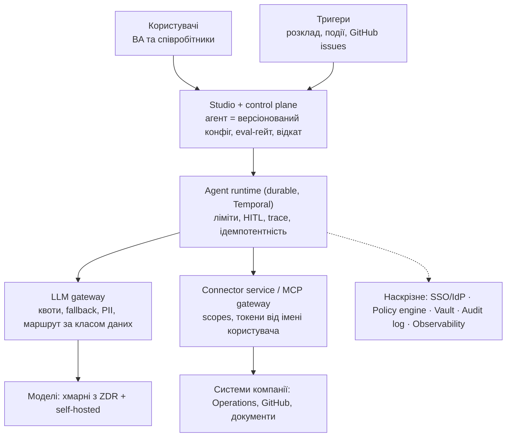

# Відповіді до техспівбесіди (Agent Platform Engineer)

Nov 14, 2026 · 

## Як користуватися

Сильна відповідь тут — це не визначення, а рішення з компромісом, прив'язане до контексту компанії: регульований домен, чутливі дані, швидке зростання, бізнес-аналітики як користувачі платформи.

Каркас для будь-якого питання:

1. **Суть** в 1–2 реченнях.
2. **Як зробив би тут**: з урахуванням TypeScript-стеку, вимог безпеки і того, що агентів будують не інженери.
3. **Компроміс**: що втрачаєш, де не варто так робити.
4. **Доказ**: приклад із досвіду або з практики на вихідних («я це зібрав і наступив ось на це»).

Чотири теми, які варто протягувати через усі відповіді: безпека за замовчуванням (least privilege, аудит), вимірюваність (evals, метрики), надійність (durable-виконання, ідемпотентність) і прагматизм build vs buy.

Це мої еталонні відповіді, а не текст для завчання. Перекажи їх своїми словами і замінюй загальні приклади на власні — інтерв'юери швидко відрізняють досвід від переказу статей.

## 1. LLM і агенти, які працюють не лише в демо

Головна думка блоку: агент — це цикл з обмеженнями, і уся інженерія в тому, як цим циклом керувати та його спостерігати.

### Як влаштований цикл агента з tool calling?

- Модель отримує системний промпт, історію та описи інструментів (назва, опис, JSON Schema аргументів).
- Вона або відповідає текстом (кінець), або повертає один чи кілька tool calls. Рантайм валідує аргументи, перевіряє права, виконує і додає результат у історію.
- Незалежні виклики можна виконувати паралельно. Помилка інструмента повертається моделі як результат з прапорцем помилки — так вона може виправитись, а не впасти.
- У проді цикл має зовнішні ліміти: максимум кроків, бюджет токенів і часу, таймаут на кожен інструмент, скасування. Кожен крок — span у трейсі.

### Що робиш, коли агент зациклюється або вигадує аргументи?

- **Зациклення**: жорсткий ліміт кроків, детектор повторів (той самий інструмент з тими самими аргументами N разів), після чого — ескалація людині або чесна відмова. Причина часто в неінформативних помилках інструментів: «Error 500» не підказує, що робити далі.
- **Вигадані аргументи**: строга схема (enum замість вільного рядка, формати ID), валідація на сервері інструмента, помилка з підказкою («замовлення не знайдено, виклич search\_orders»). Давати інструменти пошуку, щоб модель не вгадувала ID.
- **Дизайн інструментів**: менше і крупніше (не дзеркало REST API), чіткі описи з прикладами, компактний вивід з пагінацією. Десятки схожих інструментів — головна причина помилкового вибору.
- Усе це закріплюється evals на траєкторії (розділ 2), інакше виправлення одного кейсу ламає інший.

### Коли агент, а коли workflow?

- **Workflow** (детерміновані кроки з LLM у вузлах): коли послідовність відома наперед. Передбачувана ціна, легко тестувати і аудитувати. Більшість бізнес-автоматизацій для Operations — саме такі: класифікувати запит, витягти поля, створити запис.
- **Агент**: коли кроки залежать від того, що знайдено дорогою: розслідування, дослідження, фікс бага. Платимо непередбачуваністю ціни і ризиком.
- Позиція для співбесіди: починати з найпростішого, що працює, і додавати автономію лише там, де evals показують виграш. Для платформи це означає підтримувати обидва режими і гібрид: workflow, у кроці якого викликається агент з вузьким набором інструментів.

### Як керуєш контекстом, ціною і латентністю?

- **Контекст**: короткі виводи інструментів; компакція старої історії в підсумок біля порогу; великі дані в файл чи сховище з посиланням замість вставки в промпт; сабагенти з чистим контекстом для ізольованих підзадач; skills замість одного гігантського системного промпту.
- **Ціна**: prompt caching (стабільний префікс — системний промпт і інструменти — на початку, змінне в кінці); маршрутизація дешевих задач (класифікація, екстракція) на малі моделі; batch API для нетермінового; бюджети на команду в gateway.
- **Латентність**: стрімінг, паралельні tool calls, кеш відповідей інструментів, менша модель для проміжних кроків.
- Метрика, яку варто назвати: вартість і час на **успішно** виконану задачу, а не на запит.

### Structured outputs і валідація

- Одне джерело правди: zod-схема → JSON Schema для моделі → `safeParse` відповіді → тип TypeScript через `z.infer`.
- Нативний structured output провайдера гарантує форму, але не зміст. Тому бізнес-валідація окремо (чи існує SKU, чи сума в межах).
- При помилці — один повтор із текстом помилки валідації, потім фолбек або людина. Безкінечних ретраїв не робимо.

## 2. Evals

Головна думка блоку: evals — це тести для недетермінованої системи; без них будь-яка зміна промпту чи моделі — це деплой наосліп.

### Офлайн проти онлайн

- **Офлайн**: фіксований датасет, запуск у CI на кожну зміну промпту, моделі чи інструменту. Захищає від регресій.
- **Онлайн**: сигнали з проду — лайки/дизлайки, частка ескалацій, чи користувач виправив результат, LLM-judge на вибірці трейсів. Знаходить те, чого немає в датасеті.
- Замкнений цикл: погані трейси з проду розбираються вручну і стають новими кейсами офлайн-датасету. Починати варто з 20–50 реальних кейсів, а не з тисяч синтетичних.

### Ієрархія перевірок

1. **Детерміновані** (дешеві, стабільні): валідна схема, викликано потрібний інструмент, не викликано заборонений, число збігається, кроків не більше N.
2. **LLM-as-judge**: лише для того, що не перевірити кодом (точність підсумку, тон, обґрунтованість фактами з інструментів).
3. **Людська розмітка**: для калібрування judge і спірних випадків.

### Як калібрувати LLM-as-judge?

- Бінарні критерії pass/fail з чіткою рубрикою замість шкали 1–10: шкали шумні і погано відтворювані. Один judge — один критерій.
- Розмітити 50–100 прикладів вручну, порівняти з judge, дивитись на узгодженість окремо для pass і fail (точність і recall), а не загальний відсоток. Ітерувати промпт judge, поки не збігається з людьми.
- Відомі упередження: позиційне (в попарних порівняннях міняти порядок), любов до довгих відповідей, самовподобання (judge із тієї ж родини моделей).
- Просити в judge коротке обґрунтування перед вердиктом — це її стабілізує і полегшує дебаг.

### Як оцінити траєкторію, а не лише фінальну відповідь?

- Записувати кожен запуск як список кроків (інструмент, аргументи, результат) — це та сама трейс-структура, що і в observability.
- Перевірки: чи були обов'язкові кроки (спочатку `get_order`, потім `update_order`), чи не було заборонених, чи правильні ключові аргументи, скільки кроків і токенів.
- Не вимагати точного збігу всієї послідовності: модель може дійти до цілі іншим шляхом. Перевіряти інваріанти і фінальний стан системи.
- Недетермінізм: запускати кожен кейс 3–5 разів і дивитись на частку успіхів (pass@k або «усі k успішні» для критичних дій).

### Як не дати бізнес-аналітику опублікувати агента, що деградував?

- Агент в студії — це версіонований конфіг із станами draft → published. Разом із ним живе набір eval-кейсів, який аналітик наповнює просто з UI: «зберегти цей діалог як тест».
- Публікація запускає evals; якщо частка успіхів нижча за попередню версію чи поріг — публікація блокується з показом, які кейси впали.
- Платформа додає обов'язкові базові кейси для всіх (prompt injection, спроба вийти за межі прав). За бажанням — автогенерація чернетки кейсів, яку аналітик лише затверджує.
- Після публікації — canary на частину користувачів і одна кнопка відкату на попередню версію.

Інструменти, які варто знати на рівні назв: promptfoo, Braintrust, Langfuse, LangSmith, або власний ранер на vitest. Для платформи з BA-користувачами eval-двигун скоріш усе одно буде вбудований у студію.

## 3. LLM gateway

Головна думка блоку: gateway — єдина точка, через яку будь-який токен виходить з компанії, тому тут живуть політики, гроші і аудит.

### Навіщо він потрібен?

- **Контроль даних**: allowlist моделей і провайдерів (лише з ZDR-угодами чи потрібним регіоном), редагування секретів і PII, маршрутизація чутливих даних на self-hosted модель (vLLM). Для defense це перший аргумент.
- **Ключі**: ключі провайдерів лише в gateway (у vault). Команди і агенти отримують внутрішні ключі або працюють через SSO-токен; відкликання — в одному місці.
- **Гроші**: підрахунок токенів і вартості на команду, агента, користувача; бюджети з м'яким (алерт) і жорстким (блок) лімітом.
- **Надійність**: rate limit і черги, ретраї з backoff, fallback на іншого провайдера чи модель, circuit breaker.
- **Спостережуваність і аудит**: хто, коли, яка модель, скільки токенів, латентність, trace id. Повні промпти — лише за політикою зберігання і з обмеженим доступом.
- **Незалежність від вендора**: єдиний інтерфейс (зазвичай OpenAI-сумісний), заміна моделі без зміни коду агентів.

### Build vs buy

- Готові варіанти: LiteLLM (проксі на Python, найбільше провайдерів), Portkey, Envoy AI Gateway, Kong AI Gateway, Cloudflare AI Gateway. Бібліотека для абстракції провайдерів у TS — Vercel AI SDK.
- Розумна позиція: готовий шар для трансляції протоколів і fallback (це commodity), власний шар для того, що специфічно для компанії: інтеграція з SSO і політиками доступу, класифікація даних і маршрутизація, аудит у форматі компанії.
- Критерії вибору: чи можна self-host (дані не йдуть у третю хмару), технічний стек команди, швидкість підтримки нових фіч провайдерів (prompt caching, reasoning, нові типи блоків), ліцензія.
- Ризик власного gateway: найменший спільний знаменник. Якщо уніфікований API втрачає фічі провайдерів, варто підтримувати і нативний passthrough під тими ж політиками.

### Стрімінг і підрахунок токенів

- Gateway проксує SSE потік чанк за чанком, не буферизуючи відповідь, і паралельно читає події для обліку (tee стріму).
- Токени беремо з usage-події провайдера в кінці стріму (в OpenAI для цього потрібен `stream_options.include_usage`), а не рахуємо самі токенайзером.
- Якщо клієнт відвалився посеред стріму — скасувати upstream-запит (AbortController) і все одно записати часткове споживання, інакше бюджети брешуть.
- Fallback можливий лише до першого чанка: після того, як клієнт отримав частину відповіді, прозоро переключитись уже не вийде.
- Rate limit токенів на стрімі: резервувати оцінку (max\_tokens) на старті, а після завершення коригувати на факт.

## 4. MCP, skills, connector service

Головна думка блоку: MCP дає агенту доступ до систем, skills дають йому знання процедур, а connector service робить цей доступ керованим і безпечним.

### Примітиви MCP

- Сервер надає: **tools** (дії, які обирає модель), **resources** (дані для контексту, які обирає застосунок), **prompts** (шаблони, які обирає користувач).
- Клієнт може надавати серверу: **sampling** (сервер просить виклик LLM через клієнта), **elicitation** (сервер просить у користувача додаткові дані), **roots** (межі файлової системи).
- Протокол — JSON-RPC 2.0 з узгодженням можливостей на старті сесії. Цінність для платформи: один конектор працює в студії, в Claude Code, в Cursor і так далі.

### Транспорти

- **stdio**: сервер — локальний підпроцес клієнта. Просто, але довіра на рівні машини і секрети в env. Для компанійної платформи підходить лише для локальних інструментів розробника.
- **Streamable HTTP**: віддалений сервер, один HTTP-ендпоінт, відповідь звичайним JSON або стрімом SSE. Замінив старий HTTP+SSE. Саме це варіант для connector service: централізоване розгортання, auth, логи, масштабування.

### Авторизація

- У специфікації — OAuth 2.1. MCP-сервер є resource server, а токени видає окремий authorization server (у вас — корпоративний IdP). Сервер публікує Protected Resource Metadata, щоб клієнт знайшов, куди йти по токен.
- Токен прив'язаний до конкретного сервера (audience, resource indicators), і сервер це перевіряє.
- **Token passthrough заборонений**: MCP-сервер не передає отриманий токен далі в ERP. Для upstream — свій токен (token exchange або збережений OAuth-грант користувача).

### Від чийого імені агент ходить у систему? Confused deputy

- **Делегування (on behalf of user)**: агент має не більше прав, ніж користувач, аудит показує реальну людину. Дефолт для інтерактивних агентів.
- **Сервісний акаунт**: для фонових агентів без людини (нічна звірка). Окремий акаунт на кожного агента, вузькі scopes, людина-власник.
- **Confused deputy**: агент з широкими правами виконує дію за запитом користувача, який сам цієї дії зробити не може. Наприклад, спільний бот з admin-токеном ERP показує зарплати будь-кому, хто спитає. У специфікації MCP є частний випадок: MCP-проксі зі статичним client ID до стороннього API, де треба окреме підтвердження для кожного клієнта.
- Рішення: ефективні права = перетин прав користувача і прав агента, і перевірка в момент виклику інструменту, а не лише на вході в студію.

### Tool poisoning і prompt injection

- **Tool poisoning**: шкідливі інструкції в описі інструменту або «rug pull» — опис змінюється після схвалення. Захист: allowlist MCP-серверів, рев'ю і пінінг версій (хеш опису інструментів), алерт на зміну.
- **Prompt injection через дані**: текст із тікета, листа чи нотатки до замовлення потрапляє в контекст і керує агентом. Повністю це не лікується промптом чи класифікатором — це важливо чесно сказати.
- **Lethal trifecta** (Simon Willison): небезпека виникає, коли в одному агенті зустрічаються доступ до приватних даних, недовірений контент і канал назовні. Архітектурний захист — розірвати одну з трьох складових.
- Практика: немає довільних HTTP-запитів і рендеру зовнішніх картинок у відповіді (канал витоку); підтвердження людиною для дій, що щось змінюють; тегування недовірених даних у контексті; для ризикових сценаріїв — патерн «карантинної» моделі, яка читає недовірене, але не має інструментів.

### Skills: що це і чим відрізняється від MCP

- Skill — папка з `SKILL.md` (назва і опис у frontmatter, далі інструкції) та додатковими файлами і скриптами.
- **Progressive disclosure**: у контексті завжди лише назва і опис; тіло підвантажується, коли задача підходить; додаткові файли — за потреби. Так можна мати сотні skills без роздування контексту.
- MCP відповідає на «що агент може зробити», skill — на «як у нас це роблять». Приклад: MCP дає доступ до ERP, а skill «оформлення рекламації постачальнику» описує кроки, шаблони і правила.
- Для BA це найприродніший формат: знання процесу пишуться текстом, без коду. Платформа дає реєстр skills з версіями і рев'ю (скрипти в skill — це код, і до нього ті самі вимоги безпеки).

### Що робить connector service

- Реєстр конекторів (внутрішні MCP-сервери + схвалені зовнішні) з власниками, версіями і рівнем ризику кожного інструмента (читання / запис / незворотна дія).
- Зберігання OAuth-токенів користувачів у vault, оновлення, відкликання при депровіжинінгу в SSO.
- MCP gateway: агент бачить лише дозволені йому інструменти; політика і аудит на кожен виклик; rate limit до кожної upstream-системи, щоб агент не поклав ERP.
- Шаблон для нового конектора (репо + SDK + тести + деплой), щоб інші команди могли писати їх самі.

## 5. Безпека

Головна думка блоку: агент — це новий тип актора в системі, який має бути так само ідентифікований, обмежений і записаний в аудит, як людина, але з меншою довірою.

### OIDC проти SAML

- **OIDC**: надбудова над OAuth 2.0, JSON і JWT (ID token), добре підходить для SPA, мобайлу і API. Дефолт для нової платформи: Authorization Code + PKCE.
- **SAML**: XML-асерти, старий стандарт enterprise SSO, лише для браузерних сценаріїв. Підтримувати, якщо цього вимагає IdP компанії.
- Не забути про **SCIM**: автоматичне створення і видалення користувачів і груп. Людина звільнилась — її агенти і OAuth-токени мають зупинитись того ж дня. Це сильна деталь для відповіді.

### RBAC, ABAC, ReBAC

- **RBAC**: ролі з груп IdP («ops-analyst може створювати агентів з конектором ERP-read»). Просто, але ролі розмножуються.
- **ABAC**: атрибути запиту і даних (країна офісу, класифікація даних, час). Актуально для компанії з офісами в кількох країнах: різні юрисдикції і, можливо, експортний контроль даних.
- **ReBAC** (підхід Google Zanzibar, OpenFGA, SpiceDB): доступ через стосунки («власник агента», «член команди, якій агент пошерений»). Підходить для студії з поширенням агентів.
- Прагматична відповідь: RBAC з груп IdP на старті, але винести рішення про доступ в окремий policy engine (OPA, Cedar, OpenFGA), щоб не розмазати перевірки по коду і мати можливість перейти до ABAC/ReBAC.

### Ідентичність агента і користувача

- У кожному виклику два суб'єкти: **хто ініціював** (людина або тригер) і **хто виконує** (агент конкретної версії). У токені це виражається як sub + act (OAuth token exchange, RFC 8693).
- Ефективні права = перетин прав людини і прав, виділених агенту. Агент, якого створив BA, не отримує права BA автоматично: користувач агента діє в межах власних прав.
- Короткоживучі токени для кожного запуску, а не довгі статичні ключі.

### Дизайн аудит-логу

- Запис на кожну значущу подію: timestamp, ініціатор, агент і його версія, run id / trace id, дія (виклик моделі, виклик інструменту, зміна конфігу, публікація, зміна прав), ресурс, рішення політики (allow/deny і чому), хто підтвердив (якщо був HITL), результат.
- Аргументи — хешем або з редагуванням PII. Повний вміст промптів — в окремому сховищі з жорстким доступом і строком зберігання.
- Append-only: окреме сховище, до якого сервіси можуть лише дописувати (WORM / object lock, або хеш-ланцюжок для виявлення підробок). Аудит не те саме, що дебаг-логи.
- Відповідь на питання «хто і чому створив цей запит на закупівлю» має знаходитись за хвилини.

### Human-in-the-loop, sandbox, kill switch

- **HITL**: інструменти маркуються за ризиком; для запису і незворотних дій агент зупиняється й показує людині точні аргументи. Підтвердження прив'язується до хешу цих аргументів, щоб агент не підмінив їх після. Проблема approval fatigue: якщо підтверджувати все, люди перестають читати.
- **Sandbox**: код, який пише агент, виконується в ізоляції (контейнер з gVisor або microVM на кшталт Firecracker), без мережі або з egress allowlist, без секретів, з лімітами CPU, пам'яті і часу.
- **Kill switch**: вимкнути конкретного агента, інструмент або конектор для всіх за секунди, без деплою.

Референс для повторення: OWASP Top 10 for LLM Applications — мати загальне уявлення про усі пункти, особливо надмірну автономію та витік системних промптів.

## 6. Прод, надійність, on-call

Головна думка блоку: агентна платформа — це розподілена система з ненадійними залежностями і довгими операціями; до неї застосовні всі звичні практики SRE плюс кілька специфічних.

### Розкажи про інцидент

- Що слухають: як виявили (алерт чи користувач), що зробив спочатку для зменшення шкоди (rollback, feature flag), як знайшов причину, як комунікував, що змінилось після blameless-постмортему.
- Ключова думка: спочатку зупинити кровотечу, потім розбиратись. Каркас історії — у розділі 10.
- Типові агентні інциденти, які варто вміти назвати: агент у циклі спалив бюджет за ніч; провайдер тихо оновив модель і якість впала; агент зробив дублі записів через ретрай; закінчився OAuth-токен конектора і всі агенти впали.

### SLO для агентної платформи

- **Платформа** (твоя відповідальність): доступність gateway і рантайму, частка запусків без платформних помилок, додана gateway латентність (p95), час до першого токена.
- **Агенти** (спільно з власниками): частка успішно виконаних задач, частка ескалацій, вартість задачі.
- Розділяти ці два рівні важливо: падіння якості одного агента не має будити платформний on-call вночі. Алерти — на швидкість вигорання error budget (burn rate), а не на одиничні помилки.
- Додаткові алерти: аномалія витрат (агент спалив у 10 разів більше за годину), сплеск deny від policy engine, термін дії сертифікатів і токенів.

### Провайдер повертає 429 або лежить

- **429**: поважати `retry-after`, експоненційний backoff з jitter, ліміт спроб. Краще не доводити до 429: власний лімітер у gateway з пріоритетами (інтерактивні запити вище за фонові батчі).
- **Outage**: circuit breaker → fallback на ту саму модель у іншого хостинг-провайдера (наприклад, через Bedrock або Vertex) або на еквівалентну модель.
- Нюанс, який варто сказати: fallback на іншу модель змінює поведінку агента. Тому fallback-модель теж проходить evals, і для критичних агентів краще черга і очікування, ніж неперевірена модель.
- Для durable-запусків outage — це просто пауза: activity ретраїться, поки провайдер не повернеться, і запуск продовжиться з того ж кроку.

### Ідемпотентність викликів інструментів

- Ретраї неминучі (мережа, падіння воркера, а ще модель може сама вирішити викликати інструмент двічі).
- Кожен виклик, що має побічний ефект, несе idempotency key: наприклад, хеш (run id + номер кроку + нормалізовані аргументи). Конектор зберігає ключ і на повтор повертає збережений результат.
- Якщо upstream не підтримує ідемпотентність — перевірка перед записом («чи вже є заявка з цим external\_ref») або outbox-патерн.

### Observability

- Кожен запуск агента = один trace: span на кожен виклик моделі і інструменту. Стандарт атрибутів — OpenTelemetry GenAI semantic conventions (модель, токени, провайдер, назва інструменту).
- Куди відправляти: Langfuse (можна self-host, що важливо для defense) або звичний стек Grafana/Tempo. Для аналітики витрат — окрема таблиця або ClickHouse.
- Корисне для BA: візуальний перегляд трейсу прямо в студії (чому агент зробив те, що зробив) — це знімає частину звернень до платформної команди.

### Durable workflows (Temporal)

- **Чому агенту це потрібно**: запуск може тривати хвилини чи дні (чекає підтвердження людини). Деплой, падіння пода чи outage провайдера не мають втрачати прогрес і гроші вже спалених токенів.
- **Як це працює**: workflow-код детермінований і лише оркеструє; усі побічні ефекти (виклик моделі, інструменти) — в activities з політиками ретраїв і таймаутами. Історія подій зберігається; після рестарту workflow відтворюється (replay), а вже виконані activities не викликаються вдруге.
- **Детермінізм**: у workflow не можна `Date.now()`, `Math.random()`, мережу чи довільні таймери (TS SDK замінює їх детермінованими версіями в пісочниці). Зміна коду workflow при активних запусках потребує версіонування (patching).
- **HITL**: workflow чекає signal або update від UI з таймаутом; чекання не займає ресурсів. Довгі діалоги — continue-as-new, щоб історія не росла безкінечно.
- **Альтернативи**: Restate, Inngest, Trigger.dev, DBOS, Cloudflare Workflows. Компроміс Temporal — операційна складність (кластер і база) та крива навчання детермінізму.

## 7. Software factory

Головна думка блоку: цінність фабрики не в кількості PR, а в частці PR, які змерджили без суттєвих правок і без ревертів, при помірних витратах часу рев'юерів.

### Як виглядає конвеєр

1. **Вхід**: issue з лейблом, алерт із Sentry, запланована рутина (оновлення залежностей, флейкі тести).
2. **Тріаж**: автоматична оцінка, чи задача підходить агенту (є чіткий опис, локальна зміна, є тести). Якщо ні — людині з поясненням, чого бракує.
3. **Виконання**: агент (Claude Code, Codex тощо) у ефемерному sandbox з клоном репо, без прод-секретів, з обмеженим egress, лімітом часу і токенів. Він сам проганяє тести і лінтер.
4. **PR**: з поясненням змін, посиланням на issue і трейс сесії. Повний CI.
5. **Рев'ю людиною** — обов'язково. Агент не мерджить сам (branch protection), а відповідальність за код лишається на людині, яка натиснула merge.
6. **Зворотний зв'язок**: коментар рев'юера запускає нову ітерацію агента; повторювані зауваження стають правилами в CLAUDE.md / AGENTS.md репо.

### Які задачі підходять агентам

- **Добре**: баги зі стектрейсом і відтворенням, дописування тестів, міграції за шаблоном, оновлення залежностей із фіксом зламаних місць, дрібні UI-зміни, документація.
- **Погано**: розмиті вимоги, архітектурні рішення, зміни через багато репо, безпека і авторизація, код без тестів (немає чим перевірити результат).
- Специфіка домену: код, що їде на залізо (фірмвар), найпевніше, поза фабрикою або з дуже жорстким рев'ю. Варто це прояснити на співбесіді, а не стверджувати.

### Метрики

- Частка змерджених PR від створених; частка змерджених без додаткових комітів людини.
- Частка ревертів і багів, занесених агентними PR (за 30 днів).
- Час від issue до мерджу; час рев'юера на PR (якщо агентні PR рев'юють довше за людські, фабрика перекладає роботу, а не зекономлює).
- Вартість на змерджений PR. Розбивка по типах задач, щоб розуміти, де розширювати автономію, а де звужувати.

### Як покращувати воркфлоу

- Розбирати відхилені PR як eval-дані: чому відхилили — брак контексту, слабкі тести, поганий опис issue?
- Інвестувати в те, що допомагає і людям, і агентам: швидкі тести, типізація, тестове середовище, яке піднімається однією командою, інструкції в репо.
- Поступово розширювати класи задач, де метрики добрі, і додати AI code review як перший прохід для всіх PR (він не замінює людину).

## 8. No-code для бізнес-аналітиків

Головна думка блоку: платформа дає BA свободу в логіці агента, але не в безпеці та надійності: ці речі вбудовані і їх не можна вимкнути.

### Агент як декларативний конфіг

- Агент = документ (JSON/YAML зі схемою): інструкції, модель із дозволеного списку, skills, конектори і конкретні інструменти, тригери, ліміти, власник, аудиторія.
- UI студії — лише редактор цього документа. Звідси: версіонування і diff між версіями, відкат, рев'ю перед публікацією, експорт у git для інженерів. Валідація конфігу тією ж zod-схемою на фронті і бекенді.
- Обережно з графовим редактором в стилі n8n: він добрий для workflow, але для агента часто достатньо форми «інструкції + інструменти + тести». Рішення залежить від того, що реально будують аналітики — варто подивитись на перші 10 агентів.

### Що платформа дає на старт

- **Шаблони** під типові задачі («відповідач на питання по документах», «обробка вхідних заявок», «щоденний звіт»).
- **Безпечні дефолти**: новий агент має лише читання; запис додається явно і вмикає HITL; аудиторія — лише сам автор, поки не опубліковано.
- **Playground** з переглядом трейсу і кнопкою «зберегти як тест», плюс моки або staging-дані конекторів, щоб експерименти не лізли в продовий ERP.
- **Видимість**: скільки коштує агент, як часто успішний, хто ним користується.
- **Власність і життєвий цикл**: в кожного агента є власник; агенти без власника чи без використання N днів архівуються, щоб не було зоопарку забутих ботів з доступами.

### Як перетворити фідбек на роадмап

- Перші команди — вручну і поруч: сісти з аналітиком Operations і разом зібрати першого агента. Місця, де він застряг, — це роадмап.
- Канал запитів + тегування (новий конектор, UX, якість агента, доступи). Додатково дивитись на телеметрію: де користувачі кидають створення агента.
- Пріоритезація за бізнес-ефектом: скільки годин на тиждень заощадить фіча і для скількох команд. Фіча, запитана трьома командами, стає платформною; унікальна — шаблоном або кастомним інструментом.
- Метрики платформи як продукту: активні автори агентів, активні користувачі, час від ідеї до опублікованого агента, заощаджені години (за оцінкою власників).

### Як казати «ні»

- Не «ні», а «не так і не зараз»: пояснити ризик або ціну, запропонувати альтернативу (вужчий доступ, HITL, пілот на staging) і дату, коли повернутись до питання.
- Жорсткі «ні» без перемовин: агент з admin-доступом до всього, секрети в промпті, зовнішній несхвалений MCP-сервер, незворотні дії без підтвердження.
- Краще, коли «ні» каже платформа (політика з поясненням у UI), а не ти особисто в чаті: це масштабується і не псує стосунки.

## 9. TypeScript і лайвкодинг

Головна думка блоку: показати, що типи для тебе — це спосіб зробити неможливі стани неможливими, а не анотації для лінтера. На лайвкодингу говори вголос про крайові випадки до того, як писати код.

### Концепти, які можуть спитати

- **Генеріки**: тип виводиться з аргументу (`defineTool<S>` нижче дає типізовані `args` у `run` зі схеми). Обмеження `extends`, умовні типи та `infer` — на рівні «знаю, коли потрібно».
- **Discriminated unions**: стан агента або відповідь моделі як `{type: "text"} | {type: "tool_calls"}`, звуження через `switch` і перевірка повноти через `never`.
- **zod**: одна схема → валідація в рантаймі + тип через `z.infer` + JSON Schema для моделі. Типи TS зникають у рантаймі, тому все, що приходить ззовні (відповідь LLM теж), валідується.
- **Event loop**: Node однопотоковий для JS; microtasks (проміси) виконуються до наступної macrotask (таймери, I/O). Для gateway це означає: I/O-навантаження — добре, а важкий CPU (величезний `JSON.parse`, редагування PII регексами на мегабайтах) блокує всі стріми → worker threads або окремий сервіс.
- **Стріми і асинхронні ітератори**: `for await`, `async function*`, Web Streams (`ReadableStream`, `tee()`), backpressure. Скасування через `AbortController` аж до upstream-запиту.
- **Помилки**: у `catch` змінна має тип `unknown`; розрізняти очікувані помилки (повертати як значення, як виклик інструменту моделі) і баги (кидати). `Promise.allSettled` замість `Promise.all`, коли одна помилка не має валити все.

### Заготовка 1: retry з backoff і jitter

Що проговорити: ретраїти лише 429 і 5xx; jitter розмазує повтори багатьох клієнтів; Retry-After має пріоритет; ретрай безпечний лише для ідемпотентних операцій.

```ts
class HttpError extends Error {
  constructor(public status: number, public retryAfterMs?: number) {
    super(`HTTP ${status}`);
  }
}

const sleep = (ms: number, signal?: AbortSignal) =>
  new Promise<void>((resolve, reject) => {
    const t = setTimeout(resolve, ms);
    signal?.addEventListener("abort", () => {
      clearTimeout(t);
      reject(signal.reason);
    }, { once: true });
  });

const isRetryable = (e: unknown) =>
  e instanceof HttpError && (e.status === 429 || e.status >= 500);

export async function withRetry<T>(
  fn: (attempt: number) => Promise<T>,
  { retries = 4, baseMs = 250, maxMs = 8_000, signal }: {
    retries?: number; baseMs?: number; maxMs?: number; signal?: AbortSignal;
  } = {},
): Promise<T> {
  for (let attempt = 0; ; attempt++) {
    try {
      return await fn(attempt);
    } catch (e) {
      if (attempt >= retries || !isRetryable(e)) throw e;
      const backoff = Math.random() * Math.min(maxMs, baseMs * 2 ** attempt);
      const hinted = e instanceof HttpError ? e.retryAfterMs : undefined;
      await sleep(hinted ?? backoff, signal);
    }
  }
}
```

### Заготовка 2: token bucket

Що проговорити: це лімітер в пам'яті одного процесу; для кількох інстансів gateway — Redis з атомарним Lua-скриптом. Для LLM `cost` = очікувані токени, а не 1 запит.

```ts
export class TokenBucket {
  private tokens: number;
  private last = Date.now();
  constructor(private capacity: number, private refillPerSec: number) {
    this.tokens = capacity;
  }
  private refill() {
    const now = Date.now();
    this.tokens = Math.min(
      this.capacity,
      this.tokens + ((now - this.last) / 1000) * this.refillPerSec,
    );
    this.last = now;
  }
  tryTake(cost = 1): boolean {
    this.refill();
    if (this.tokens < cost) return false;
    this.tokens -= cost;
    return true;
  }
}
```

### Заготовка 3: парсинг SSE

Що проговорити: чанки не збігаються з межами подій, тому буфер; `stream: true` у TextDecoder, щоб не розірвати багатобайтовий символ (кирилиця!); кілька рядків `data:` склеюються.

```ts
export async function* parseSSE(body: ReadableStream<Uint8Array>) {
  const reader = body.getReader();
  const decoder = new TextDecoder();
  let buf = "";
  while (true) {
    const { value, done } = await reader.read();
    if (done) break;
    buf += decoder.decode(value, { stream: true }).replace(/\r\n/g, "\n");
    let idx: number;
    while ((idx = buf.indexOf("\n\n")) !== -1) {
      const raw = buf.slice(0, idx);
      buf = buf.slice(idx + 2);
      let event = "message";
      const data: string[] = [];
      for (const line of raw.split("\n")) {
        if (line.startsWith("event:")) event = line.slice(6).trim();
        else if (line.startsWith("data:")) data.push(line.slice(5).trimStart());
      }
      if (data.length) yield { event, data: data.join("\n") };
    }
  }
}
```

### Заготовка 4: інструменти на zod і мінімальний цикл агента

Що проговорити: невалідні аргументи і помилки повертаються моделі з підказкою, а не валять запуск; інструменти з `risk: "write"` чекають підтвердження людини (за замовчуванням — відмова); ліміт кроків. У проді сюди додаються таймаути, трейси і перевірка прав.

```ts
import { z } from "zod";

type Tool<S extends z.ZodTypeAny = z.ZodTypeAny> = {
  name: string;
  description: string;
  schema: S;
  risk: "read" | "write";
  run: (args: z.infer<S>) => Promise<unknown>;
};

const defineTool = <S extends z.ZodTypeAny>(t: Tool<S>) => t;

const getOrder = defineTool({
  name: "get_order_status",
  description: "Get status of an order by its id, e.g. ORD-1042",
  schema: z.object({ orderId: z.string().regex(/^ORD-\d+$/) }),
  risk: "read",
  run: async ({ orderId }) => ({ orderId, status: "shipped" }),
});

type ModelTurn =
  | { type: "text"; text: string }
  | { type: "tool_calls"; calls: { id: string; name: string; args: unknown }[] };

type Message =
  | { role: "user" | "assistant"; content: string }
  | { role: "tool"; toolCallId: string; content: string; isError?: boolean };

type CallModel = (messages: Message[], tools: Tool[]) => Promise<ModelTurn>;

export async function runAgent(
  callModel: CallModel,
  tools: Tool[],
  input: string,
  opts: { maxSteps?: number; approve?: (name: string, args: unknown) => Promise<boolean> } = {},
): Promise<string> {
  const { maxSteps = 10, approve = async () => false } = opts;
  const byName = new Map(tools.map((t) => [t.name, t]));
  const messages: Message[] = [{ role: "user", content: input }];

  for (let step = 0; step < maxSteps; step++) {
    const turn = await callModel(messages, tools);
    if (turn.type === "text") return turn.text;

    messages.push({ role: "assistant", content: JSON.stringify(turn.calls) });
    const results = await Promise.all(turn.calls.map(async (call) => {
      const tool = byName.get(call.name);
      const fail = (msg: string) =>
        ({ role: "tool", toolCallId: call.id, content: msg, isError: true }) as const;
      if (!tool) return fail(`Unknown tool ${call.name}. Available: ${[...byName.keys()].join(", ")}`);
      const parsed = tool.schema.safeParse(call.args);
      if (!parsed.success) return fail(`Invalid args: ${parsed.error.message}`);
      if (tool.risk === "write" && !(await approve(tool.name, parsed.data))) {
        return fail("Action rejected by human reviewer");
      }
      try {
        const out = await tool.run(parsed.data);
        return { role: "tool", toolCallId: call.id, content: JSON.stringify(out) } as const;
      } catch (e) {
        return fail(`Tool failed: ${(e as Error).message}`);
      }
    }));
    messages.push(...results);
  }
  throw new Error(`Agent exceeded ${maxSteps} steps`);
}
```

Усі чотири заготовки пройшли `tsc --strict` і димовий прогін (zod 3). На співбесіді не відтворюй їх дослівно — важливіше пояснити, навіщо кожна перевірка.

## 10. Поведінкові питання

Головна думка блоку: вакансія прямо каже про ownership і роботу без плейбука, тому в кожній історії має бути чутно, що рішення приймав ти, і чим це закінчилось у цифрах.

Формат STAR: **S**ituation (2 речення) → **T**ask (що саме було на тобі) → **A**ction (найдовша частина, «я», а не «ми») → **R**esult (числа + що зробив би інакше). На кожну історію — до 2 хвилин.

### Історія 1: прототип → продакшн

- Це найближче до задачі ролі, підготуй її найретельніше.
- Що показати: як оцінив прототип (що залишити, що переписати), як пріоритезував (спочатку auth, спостережуваність і тести, потім фічі), як не зупиняв користувачів під час переходу.
- Результат у цифрах: доступність, кількість користувачів, час на онбординг, кількість інцидентів.

### Історія 2: інцидент на on-call

- Структура: сигнал → перша дія для зменшення шкоди → пошук причини → комунікація → постмортем → що змінилось системно (алерт, тест, ранбук).
- Що не робити: шукати винних, закінчувати на «пофіксили».

### Історія 3: задача без плейбука

- Що показати: як знайшов контекст (джерела, люди, швидкий прототип для перевірки гіпотези), як прийняв рішення з неповною інформацією, як зробив його зворотним.
- Добре лягає історія, де ти швидко занурився в нову область. Це прямо підтверджує твій аргумент про швидке набуття бракуючого контексту.

### Історія 4: конфлікт пріоритетів або «ні» стейкхолдеру

- Що показати: ти розібрався в справжній потребі за запитом, запропонував альтернативу, стосунки не постраждали.
- Для цієї ролі ідеально: запит на широкий доступ або «зробіть швидше, без безпеки».

### Часті питання поза STAR

- **«Розкажи про LLM-систему, яку ти довів до проду»**: головний фільтр за вимогою «beyond demos». Називай конкретні проблеми, які виникли після демо: деградація якості, ціна, латентність, дивні вхідні дані — і як їх розв'язував.
- **«Чого з вакансії ти не робив?»**: чесно і в три кроки — «у проді X не робив; робив суміжне Y; за вихідні зібрав Z і наступив на ось це». Це сильніше за блеф.
- **«Чому саме ця компанія і цей домен?»**: власна мотивація + що цікавить технічно: внутрішня AI-платформа в компанії, яка швидко росте міжнародно, — рідкісна нагода будувати фундамент з нуля, а вимоги безпеки тут справжні.
- **«Що зробиш за перші 30/60/90 днів?»**: 30 — аудит прототипу, розмови з користувачами, список ризиків, найкритичніші фікси (секрети, доступи, алерти); 60 — gateway і SSO в проді, перша інтеграція з Operations з аудитом; 90 — eval-гейт для публікації, онбординг 2–3 команд, роадмап з їхнього фідбеку. Уточни, що готовий скоригувати план після аудиту.

## 11. System design: прохід уголос

На запит «спроєктуй агентну платформу» сильний прохід займає 35–45 хвилин: близько 5 на вимоги, 10 на верхній рівень і один запит наскрізь, 15 на два глибоких занурення, решта — відмови і етапи.



Агент ніколи не тримає ключів і не ходить у системи напряму: моделі — лише через gateway, інструменти — лише через connector service, і обидва перевіряють права, пишуть аудит і trace.

### Крок 1. Уточнити вимоги

- Хто користувачі і скільки їх: сотні співробітників, десятки BA?
- Які дані чутливі і чи можуть вони йти до хмарних провайдерів?
- Які системи в Operations, чи є в них API і тестове середовище?
- Агенти інтерактивні, фонові чи обидва? Чи потрібні дії із записом?
- Вимоги до аудиту і зберігання даних, з урахуванням кількох юрисдикцій (Україна, Фінляндія, США)?
- Грубий масштаб: запусків на день і пікове навантаження.

### Крок 2. Пройти один запит наскрізь

Приклад: BA опублікував агента «перевір залишки і створи заявку на закупівлю», оператор складу пише йому в чаті.

1. Оператор заходить через SSO, токен несе його групи.
2. Runtime стартує durable-запуск опублікованої версії агента з trace id.
3. Виклик моделі йде через gateway: квота команди, маршрут на дозволену модель.
4. Модель кличе `list_low_stock`. Connector service питає policy engine (права оператора ∩ права агента), бере з vault токен від імені оператора, пише аудит.
5. Модель пропонує `create_purchase_request`. Це запис, тому запуск стає на паузу; оператор бачить точні аргументи і підтверджує.
6. Виклик йде з idempotency key, запуск завершується, усе видно в trace і аудиті.

### Крок 3. Два глибоких занурення

Обирай за реакцією інтерв'юера або запропонуй сам: authz і делегування (розділи 4 і 5), gateway (розділ 3), durable runtime і HITL (розділ 6), eval-гейт і життєвий цикл агента (розділи 2 і 8). Для defense-компанії authz — найпевніший вибір.

### Крок 4. Відмови

- Провайдер лежить → runtime чекає або переходить на перевірений fallback.
- ERP повільний → rate limit у connector service, таймаути, ретраї activity.
- Prompt injection у даних складу → запис лише через HITL, немає каналу витоку.
- Витік токена → короткоживучі токени, відкликання через SCIM і vault.
- Агент поводиться дивно → kill switch і відкат на попередню версію.

### Крок 5. Етапи

- **MVP (перші 1–2 місяці)**: gateway, SSO, аудит, один конектор до Operations, runtime з HITL.
- **Далі**: eval-гейт, окремий policy engine, SDK для конекторів, software factory на тій самій платформі.
- **Свідомо відкласти**: власний графовий редактор, складні мультиагентні оркестрації, fine-tuning. Сказати, що не будуєш на старті і чому, часто цінується вище за довгий список фіч.
