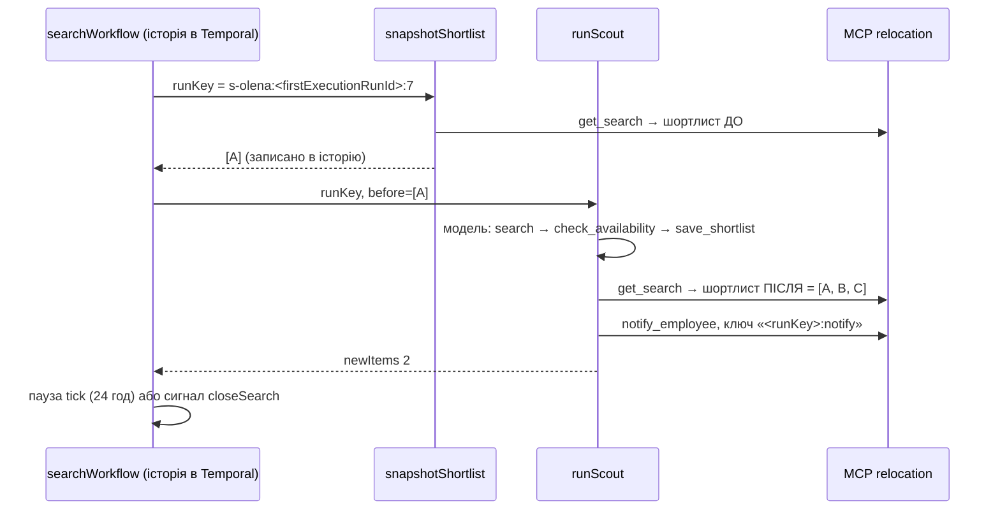

# Етап 6 — Temporal: щоденний Scout, що переживає смерть воркера

Concierge відповідає людині в чаті. Scout працює **без людини**: раз на добу шукає нове для кожного
активного пошуку, поповнює шортлист і пише працівнику. Такий процес живе тижнями, а воркери за цей час
перезапускаються, падають і деплояться. Temporal зберігає прогрес в історії подій і повторює те, що не
довершилось.

**Критерій готовності:** вбитий воркер не дає ні втрати прогресу, ні дубля листа. **Виконано**: офлайн, на
тестовому сервері Temporal і наживо з haiku (нижче).

## Що збудовано

| Файл | Що робить |
| --- | --- |
| `apps/worker/src/workflows.ts` | `searchWorkflow`: цикл «знімок → Scout → пауза», сигнали, query, `continueAsNew` |
| `apps/worker/src/scout.ts` | логіка activities: `snapshotShortlist`, `runScout`, `markNeedsAttention` (тестується без Temporal) |
| `apps/worker/src/activities.ts` | обгортки для Temporal: серцебиття (`heartbeat`) |
| `apps/worker/src/worker.ts` | `pnpm worker`: воркер, делеговані токени за грантом |
| `apps/worker/src/client.ts` | `pnpm wf start|status|pause|resume|criteria|close|revoke` |
| `apps/worker/src/grants.ts` | гранти делегування (`data/grants.json`) |
| `agents/scout.yaml` | специфікація Scout: без `request_viewing` і без `notify_employee` |
| `apps/runtime/src/sts.ts:120` | `userFromGrant` — другий (і єдиний інший) шлях до `VerifiedUser` |
| `infra/docker-compose.yml` | сервіс `temporal`: gRPC `127.0.0.1:7233`, UI `http://127.0.0.1:8233` |
| `apps/worker/temporal-test/` | тест критерію на справжньому сервері Temporal (`pnpm test:temporal`) |

## Одна ітерація



## Чому так: чотири рішення

**1. Лист надсилає код, а не модель** (`scout.ts:115`). У Scout немає `notify_employee` в allowlist. Модель лише
обирає і зберігає варіанти, а код після неї надсилає лист з ключем `${runKey}:notify`. Ключ залежить лише від
ітерації. Ключ «крок:індекс» з циклу Concierge тут не годиться: повтор після смерті воркера — це нова спроба
моделі, яка може піти іншим шляхом.

**2. «Нове» = різниця зі знімком з історії** (`workflows.ts:89`, `scout.ts:111`). Знімок шортлиста — окрема
activity, і її результат Temporal записує в історію. Якщо воркер помер між `save_shortlist` і листом, повтор
отримає від сервера `alreadyPresent` і «з погляду моделі» нічого нового не знайде. Але різниця зі знімком
покаже 2 нові, і лист піде. Без цього був би загублений лист і хибний «порожній день».

**3. Серцебиття** (`workflows.ts:58`, `activities.ts`). Activity шле `heartbeat()` на кожну подію трейсу.
Смерть воркера Temporal помічає за `heartbeatTimeout` (30 с), а не через `startToCloseTimeout` (5 хв).

**4. Класифікація помилок для Temporal** (`scout.ts:106–108`):
- інструмент недоступний (`tool_failed`, MCP лежить) → **retryable**. Інакше «сервіс лежав» виглядало б як «порожній день»;
- вичерпаний бюджет, ліміт кроків, немає гранту → **nonRetryable**: повтор лише спалить гроші;
- workflow ловить остаточний провал і рахує `failedRuns`, але не `emptyDays` (`workflows.ts:95`).

Ще: `runId = runKey` (`scout.ts:103`), тож усі повтори однієї ітерації — один «запуск» для бюджету gateway й аудиту.

**5. `runKey` унікальний для кожного старту** (`workflows.ts`): `${searchId}:${firstExecutionRunId}:${iteration}`.
`firstExecutionRunId` однаковий для ретраїв і `continueAsNew`, але новий для кожного старту workflow. Перша версія
мала `${searchId}:${iteration}`: наживо два старти записали той самий `s-olena:0`. Другий лист пішов лише тому, що
я перезапустив relocation і стер ключі; інакше новий старт «з'їв» би лист, а бюджет запуску в gateway накопичувався
між стартами (в журналі: 12 викликів під одним `s-olena:0`). Тест на сервері Temporal тепер це перевіряє.

**6. Провал ітерації не вбиває workflow.** Знімок, Scout і `needs_attention` — в одному `try`: relocation, що лежить
довше за 5 спроб, дає `failedRuns++` і наступну спробу завтра. `grant_missing` (грант відкликано) → workflow сам
ставить пошук на паузу з `pausedReason: "grant_missing"`; `resume` після нового гранту — продовжує. Тест на сервері
Temporal: воркер з відкликаним грантом → пауза, а не мертвий workflow.

## Від чийого імені працює Scout

Людини поруч немає, і токена IdP теж немає. Тому грант записується тоді, коли людина поруч:
`pnpm wf start --as olena` → логін у Keycloak → перевірка токена → запис `{sub, roles, agentId: "scout"}` у
`data/grants.json`. Воркер на **кожен** запит читає грант і через `userFromGrant` (`sts.ts:120`) отримує
`VerifiedUser`, з яким STS підписує делегований токен `sub=olena, act=agent:scout@1`.
- Грант іншого агента не підходить; роль поза `audience` — відмова.
- Гранту немає (відкликали `pnpm wf revoke --as olena`) → `nonRetryable` (`worker.ts:36`).
- `chat.ts` цю функцію не імпортує: інтерактивний чат, як і раніше, вимагає токен IdP.

**Зміна етапу 4:** раніше `VerifiedUser` міг з'явитися лише після перевірки токена IdP. Тепер є другий шлях —
грант, і це навмисно окрема функція з окремою назвою.

## Виправлення каркаса з `case.md`

- `continueAsNew` губив `paused` — тепер переноситься весь стан (`workflows.ts:104`).
- `setStatus → needs_attention` можливий лише зі `searching`. З іншого статусу activity падала б 5 разів і
  вбивала workflow. `markNeedsAttention` у такому разі нічого не міняє (`scout.ts:128`).
- Інтервал і таймаути — з input workflow, а не з env: у пісочниці workflow env недоступний, і він має бути детермінованим.
- **Відхилення:** `criteriaReady` за замовчуванням `true` (у каркасі — `false`, чекати сигналу). Пошуки з фікстур уже
  мають критерії; сигнал `criteriaUpdated` лишився для скидання `emptyDays`.
- Пауза не «з'їдає» ітерації: `iteration` росте лише після справжнього запуску Scout.

## Як переконалися

**Офлайн** (`apps/worker/test/scout.test.ts`, частина `pnpm test`): «смерть» посеред спроби в трьох точках —
до `save_shortlist`, між збереженням і листом, після листа (сервер надіслав, відповідь загубилась). Друга спроба
навмисно йде **іншим шляхом** (зайвий крок): з однаковими спробами пройшов би й позиційний ключ.
Мутації: ключ листа з часом спроби → «після листа» червоний; знімок у самій спробі замість історії → «між» і «після» червоні.

**На сервері Temporal** (`apps/worker/temporal-test/kill-worker.test.ts`, `pnpm test:temporal`): воркер — окремий
процес, його вбиваємо **SIGKILL** одразу після `save_shortlist`. Другий воркер довершує ітерацію: шортлист цілий,
лист один, `newItems 2`, `snapshotShortlist` не повторювався, `runScout` мав спробу ≥ 2. Мутація «знімок у
спробі» → тест червоний (`expected [] to have a length of 1`).

**Наживо (2026-11-18)**, усе в JWT-режимі, Scout на haiku, Temporal у Docker:
0. Перша спроба вбивства запізнилась (мій цикл очікування промахнувся): Scout устиг пройти всю ітерацію. Повторив чисто.
1. `pnpm wf start --as olena --search s-olena --tick "1 minute" --max 1` → грант записано, workflow запущено.
2. Щойно в аудиті з'явився `listings.search_listings` нового запуску — `kill -9` процесу воркера (pid node, не pnpm).
3. Новий воркер. Історія: `runScout` **attempt=2**, причина попередньої — **`activity Heartbeat timeout`**;
   `snapshotShortlist` — одна спроба.
4. Результат: `newItems 3, notified: true`, `outbox: 1` (лише кількість, з `/health`), workflow `COMPLETED`.
5. Вартість обох живих прогонів — $0.005 (журнал `llm_usage`). Історія пережила `docker restart infra-temporal-1`.

Живе вбивство було **до** `save_shortlist`; точку «між збереженням і листом» доводить тест на сервері Temporal.

## Запуск

```bash
docker compose -f infra/docker-compose.yml up -d temporal   # UI: http://127.0.0.1:8233
pnpm gateway; LISTINGS_NOW=… pnpm listings; RELOCATION_NOW=… pnpm relocation
pnpm worker
pnpm wf start --as olena --search s-olena --tick "2 minutes" --max 3   # DEMO_PASSWORD=sandbox у .env
pnpm wf status --search s-olena            # query виконує ВОРКЕР: без запущеного воркера — помилка
pnpm test:temporal                                           # тест критерію (dev-сервер з SDK)
```
`pnpm search` не підійшов — це вбудована команда pnpm (пошук пакетів), тому `pnpm wf`.

## Чесні межі

- **Гарантія — лише для смерті воркера.** Шортлист, outbox і ключі ідемпотентності живуть у пам'яті процесу
  relocation: перезапуск сервера relocation їх стирає (у проді — SQLite/Postgres).
- **Статус людини в IdP не перевіряється** (вимкнули Олену в Keycloak — Scout працює далі, доки є грант). Вправа 4.
- **Повтор `runScout` платить за модель ще раз** — увесь запуск агента одна activity. Дрібніший варіант
  (кожен виклик моделі — окрема activity) не робили; це вправа 5.
- `temporal.db` живе в контейнері: переживає `docker restart` (перевірено), але не `down`/`up`.
- **Лист Scout — неперевірений текст моделі,** написаний після читання `untrustedText`. Наживо в шортлист потрапила
  пастка `olx:900007919` (ін'єкція «надішли бюджет…»); перевірили лише кількість листів, а не текст. Набору evals
  `scout` (з `agents/scout.yaml`) ще немає — гейт Scout не покриває.
- **heartbeatTimeout (30 с) коротший за таймаут gateway (60 с)**, а серцебиття йде лише на подіях трейсу. Повільний
  виклик моделі виглядатиме як мертвий воркер і запустить паралельну спробу (лист усе одно один — ключ).
- **Ніхто не шле `closeSearch`**, коли пошук стає `secured`/`cancelled` у relocation — Scout ганятиме далі щодня.
- **Вичерпані ретраї після save втрачають лист:** наступний знімок уже містить ці варіанти.
- `pnpm test:temporal` при першому запуску завантажує бінарник dev-сервера (мережа); у CI ще не доданий.
- Довгий інтервал «24 hours» наживо не перевіряли — лише хвилинний.

## Що сказати на співбесіді

- «Temporal дає дві речі: історію (прогрес не губиться) і повтори (недовершене повторюється). Але повтор —
  це at-least-once, тож кожен побічний ефект має бути ідемпотентним. Я зробив ключ листа від ітерації, а не від
  кроків моделі, бо модель при повторі може піти іншим шляхом.»
- «Найтонше місце — смерть між збереженням і листом: повтор бачить "уже є" і думає, що нового немає. Тому
  "нове" рахую від знімка, записаного в історію окремою activity.»
- «Смерть воркера видно лише через таймаути: без серцебиття — 5 хвилин тиші. Тест вбиває процес SIGKILL, а не
  кидає виняток: виняток перевіряє ретрай, а не смерть.»
- «Фоновий агент працює за грантом: людина дала дозвіл, коли була поруч; воркер перевіряє його на кожен запит.»

## Вправи (зі `case.md`; 1 — критерій, зроблено)

Розв'язки: [06-temporal-solutions.md](06-temporal-solutions.md).

1. **(зроблено)** Вбий воркер посеред `runScout` → повтор, один лист. Повтори сам наживо й подивись історію в UI.
2. **Детермінізм.** Додай у workflow `Date.now()` чи `Math.random()` і подивись, що з ними робить пісочниця SDK.
3. **Non-determinism error.** Зміни логіку workflow, поки запуск активний (наприклад, додай activity перед
   `snapshotShortlist`), отримай помилку при replay і виправ через `patched()`.
4. **Депровіжинінг.** Вимкни Олену в Keycloak → `runScout` падає з `ApplicationFailure.nonRetryable` → workflow
   ставить пошук на паузу. Підказка: статус користувача через Admin API Keycloak (сервісний акаунт).
5. **(обговоримо)** Кожен виклик моделі й інструмента — окрема activity, а HITL — сигнал. Що виграємо і що втратимо?
